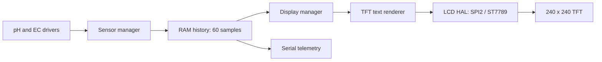

# Sensor storage and TFT display

The target is the ESP32-S3 DevKitC-1 N16R8 with the GMT130/ST7789 240x240
SPI display. The earlier display bench program used a Seeed XIAO ESP32-S3.
This implementation reuses its panel settings, with the DevKitC-1 wiring
confirmed for this project. The sibling bench project is unchanged.

## Data flow



`src/common/sensor_data.h` defines three layers of data:

- `Reading`: status, raw ADC count, pin voltage, sensor-board voltage, value.
- `Snapshot`: pH, EC25 in mS/cm, turbidity in NTU, and the manual EC temperature.
- `Record`: one snapshot, sample time in milliseconds since boot, sample number.

`src/application/data_store/` keeps the most recent 60 records in a fixed RAM
ring buffer. Each new record replaces the oldest once full. At the normal
sampling rate this is roughly one minute of history. All fields, including
failed readings, are copied into the store. The next failed sample never
silently reuses an earlier good measurement.

The store exposes `latest()` and `newest(age)` (age 0 is newest). It currently
belongs to the main application task, which also updates the display and serial
output. The store and display APIs are not thread-safe: add synchronization
before moving reads/writes to separate tasks.

This is RAM storage, not an SD-card or flash data log. Power loss/restart clears
the history. There is no wall-clock timestamp or history-browsing UI yet.

## Display wiring

Use actual ESP32 GPIO numbers, not XIAO D-pin labels.

| TFT signal | DevKitC-1 GPIO |
| --- | --- |
| SCL / SCLK | 12 |
| SDA / MOSI | 11 |
| DC | 10 |
| RES / RESET | 9 |
| CS | Not exposed on this seven-pin module |
| GND | Common ground |

Use 3.3 V logic and power/backlight connections appropriate to the module,
as in the bench setup. Backlight is not controlled by a GPIO. SDA/SCL on this
TFT are **SPI**, not I2C. SPI2 is dedicated to this display because it has no CS.
GPIO1/2 remain pH/EC inputs, and GPIO4/5/6 remain pump outputs.

`DisplayConfig` in `src/common/system_config.h` holds the pin mapping and
panel settings; `default_display_config()` enables it by default. Set `enabled`
false to run without a TFT. Shared configuration restricts display pins to
7..18 on this board and rejects duplicate pins. Both application managers check
the same sensor/display maps for sensor/pump/display conflicts before touching
GPIOs. The LCD HAL repeats the display configuration check and checks SDK pin
capabilities. Update shared pin reservations when adding required turbidity
acquisition or other peripherals.

Panel settings match the bench: SPI mode 3, 20 MHz, RGB565 with little-endian
pixel data, inversion enabled, zero vertical offset. Some modules need
`y_offset = 80`; adjust only after checking the physical screen.

## What appears on screen

```text
REACTOR SENSORS
12 S
PH 7.00
NEEDS CALIBRATION
EC 1.41 MS/CM
NEEDS CALIBRATION
TURB -- NTU
NOT READY
T 25.0 C MANUAL
EC AT 25 C
```

The second row is the sample's time since boot. Values above are examples,
not simulated data sent by the firmware. Green means calibrated, yellow means
an estimate or unavailable sensor, and red means a reading error. The text
also states the status so color is not the only indication.

Turbidity has a reserved data field but its acquisition driver is still a
scaffold, so it displays `--` and `NOT READY`. The temperature is a manual EC
compensation input, not a temperature sensor reading. EC is normalized to 25 C.

At startup the TFT shows `WAITING FOR DATA`. The formatter labels a record
older than three seconds `STALE DATA` when asked to redraw it. This is not an
independent watchdog: a stopped application or failed display can leave the
last frame frozen. Check that the seconds value keeps advancing.

## Display layers and failure behavior

- `application/display_manager/`: formats the stored data and status messages.
- `driver/tft/`: renders a small 5x7 font at double size in ten rows.
- `hal/lcd/`: owns the SPI2 bus, ST7789 commands, DMA buffer, and completion wait.

The renderer clears each strip before drawing, so shorter values erase old
digits. It uses a static 11.25 KiB strip and the HAL uses another 11.25 KiB DMA
strip, keeping large buffers off the main task's stack. The initial frame is
written before enabling the panel.

The HAL follows the ESP-IDF requirement to wait for a completed color transfer
before reusing its DMA buffer. See [Espressif LCD documentation](https://docs.espressif.com/projects/esp-idf/en/latest/esp32/api-reference/peripherals/lcd/index.html).
If initialization or a transfer fails, display updates stop until reboot and
sensor storage/serial output continue. A transfer has a 250 ms completion
timeout. On timeout the potentially active DMA buffer is retained and never
modified again. The failure is reported once over serial when logging is enabled.
SPI writes have no panel acknowledgement, so a successful initialization does
not prove the screen is connected or wired correctly.

## Verification

```bash
cmake -S src/test -B build/host-tests
cmake --build build/host-tests
ctest --test-dir build/host-tests --output-on-failure
```

Display tests use a fake LCD HAL with the actual formatter/renderer and check
history rollover, copied data, fresh errors, calibration labels, missing
turbidity, stale timestamps, pin conflicts, screen refresh, and display failures.
The firmware build checks the real ESP-IDF LCD HAL. Physical wiring, colors,
alignment, and live refresh still require a test on the DevKitC-1 and TFT.
