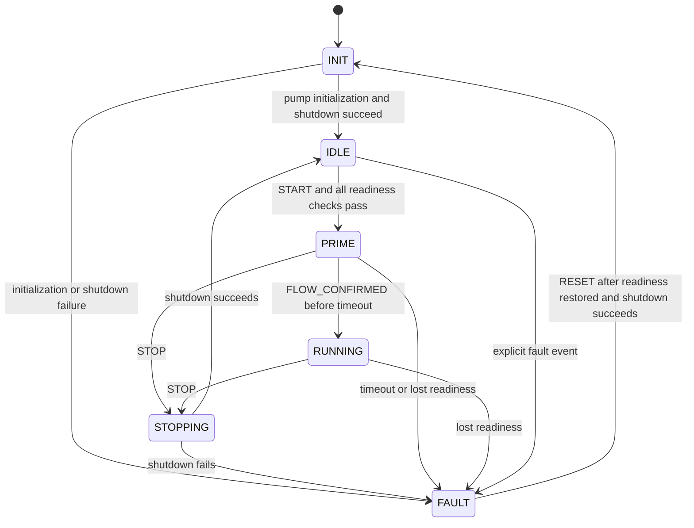

# Reactor state machine

Implemented: 2026-10-27. This is a software state machine with simulated control
tests. Physical interlocks, operator buttons/serial commands, and electrode
power control are not yet implemented.

## Current hardware behavior

The application initializes pumps at zero duty, enters IDLE when pump setup
succeeds, and continues monitoring. A pump initialization/shutdown failure
enters FAULT. The TFT shows the state at the top and the first blocked-start
reason at the bottom; serial output reports state/reason changes.

Default IDLE reason: `VERIFY PUMP FLOWS`. All saved duties are set, but combined
flow verification is still pending. Other start checks must also pass. One displayed reason
does not mean all remaining checks have passed.

The production adapter deliberately leaves verified pump flows and interlock
readiness false and supplies no power-control callback. Therefore **START is
blocked before any pumps start**, and real PRIME/RUNNING are unavailable. A
missing callback cannot control or confirm the state of an external power supply.

## Sequence



STOPPING is a synchronous transition: power-off is requested first, then pump
stop is attempted even if power-off fails. The state normally changes before
the next screen refresh, so STOPPING may not appear on the TFT. A stop request
in FAULT retries shutdown but does not clear the fault. STOP in INIT does not
bypass initialization. An active external fault remains latched on STOP.
A successful STOP in IDLE reports the current start blocker, not READY when
requirements are still missing.

## Readiness and faults

START checks, in order:

1. No active external fault.
2. Pump manager is ready and pump action callbacks exist.
3. Every stored duty is valid and above zero.
4. Actual pump flows have been verified. Nonzero duties alone do not establish this.
5. A sample exists and is no more than 3 seconds old, measured from acquisition
   start, without a future timestamp. The TFT uses the same freshness rule.
6. pH, required EC, and required turbidity all have usable, calibrated readings.
7. Interlock inputs are implemented and report acceptable conditions.
8. A real power-control callback exists.

Before priming, the FSM requests power off, then starts pumps. Priming requires
an explicit flow-confirmation event. The initial timeout is **60 seconds**;
it is a provisional software setting that needs checking against the actual
priming procedure before deployment. Confirmation at or after the deadline
causes a timeout fault, not RUNNING.

PRIME and RUNNING recheck readiness on every event/tick. A failed required
sensor, expired reading, interlock opening, or failed start causes shutdown and
a latched fault. Shutdown failure takes precedence over the triggering reason.
Faults never clear merely because sensor readings recover.

RESET requires all start-readiness checks to pass and another successful shutdown.
It returns to INIT, then initialization returns to IDLE; it never starts outputs.
Existing pump-driver hardware failures remain latched until reboot. In the
incomplete production configuration, RESET cannot satisfy the full readiness
checks; correct hardware problems and reboot for monitoring recovery.

Theoretical-pH calculation is not used as a control guard in this implementation.
Measured EC is required. The existing measured pH remains a separate input.

## Interfaces and ownership

- `state_machine::Machine` owns transitions, readiness checks, and reasons.
- `Outputs` contains start-pumps, stop-pumps, and set-power callbacks. Tests
  supply simulated callbacks; production uses the pump manager and no PSU backend.
- `Inputs` supplies a copied sensor record, time, and readiness flags.
- `app::command(Event)` submits a synchronous event using the current application
  data. `app::reactor_state()` returns the state.
- Call these APIs only from the application task. They are not interrupt-safe
  or thread-safe. Future UI/FreeRTOS tasks should send events to this owner.

Example for a future command handler in the application task:

```cpp
const bool accepted = app::command(app::state_machine::Event::Start);
// Check accepted; the current production configuration rejects this request.
```

There is no command parser, button input, automatic START, or task migration
in this update. Monitoring still uses one task with roughly one-second cycles;
the FSM is not a fast emergency-stop service or physical safety interlock.
Do not call the manual pump APIs from another task while the FSM owns operation.

## Verification

```bash
cmake -S src/test -B build/host-tests
cmake --build build/host-tests
ctest --test-dir build/host-tests --output-on-failure
```

Twenty FSM scenarios cover normal transitions, startup guards, missing power
control, priming timeout, STOP during priming, sensor failures in PRIME/RUNNING,
stale readings, interlock faults, partial pump/power start failures, failed
shutdown, fault reset, initialization failure, invalid numeric readings, and
retention of start blockers after STOP. Additional checks cover missing callbacks,
failed power-off before START, clock rollback, and loss of pump readiness.
Simulations also verify that
the real production adapter boots to IDLE and rejects START with outputs off.

Total: 50 host tests. Actual PSU shutdown, interlocks, flow confirmation hardware,
and real-time response require separate hardware integration and validation.
